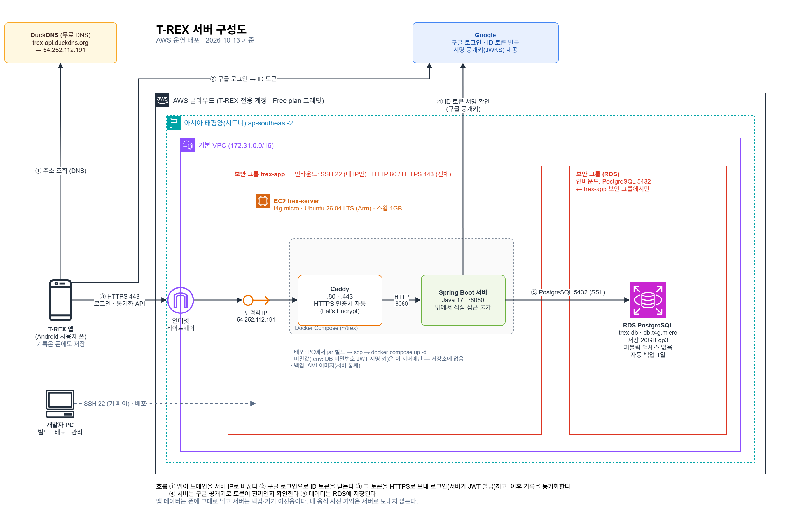

# TREX Kotlin

TREX는 Kotlin과 Jetpack Compose로 만든 Android 운동·식단 관리 앱입니다.
휴대폰 카메라로 관절을 추정해 자세 변화·반복·유지 시간을 안내하고 루틴과 수행 기록을 기기에 저장합니다.
Google 계정을 연결하면 기록을 서버에 백업하고 기기 간에 이어 쓸 수 있습니다(Spring Boot 서버, AWS 운영 — 아래 [시스템 구성](#시스템-구성-계정-백업동기화)).
아래 체험판 안내는 **Android 체험판 1.3.0-preview.7** 기준입니다. preview.7에는 계정 백업·동기화가 들어 있지 않습니다.

## 체험판 다운로드

**[TREX 1.3.0-preview.7 APK 다운로드](https://github.com/LeeDongHyun00/TREX/releases/download/v1.3.0-preview.7/TREX-1.3.0-preview.7.apk)**

[릴리스 설명·파일·체크섬](https://github.com/LeeDongHyun00/TREX/releases/tag/v1.3.0-preview.7) ·
[상세 배포 문서](docs/ANDROID_PREVIEW_RELEASE_1_3_0_7.md)

| 항목 | 현재 배포본 |
|---|---|
| 버전 | `1.3.0-preview.7` |
| 버전 코드 | `12` |
| Android | 8.0 이상(API 26) |
| 패키지 | `com.example.trex_kotlin` |
| 서명 | 기존 체험판과 동일한 개발 인증서 |
| 릴리스 자산 | APK · `SHA256SUMS.txt` · `BUILD_INFO.json` |

### preview.6에서 업데이트하기

**preview.6(versionCode 11)은 preview.7(versionCode 12)의 앱 내 업데이트 안내 대상입니다.**
앱은 공개된 GitHub 릴리스와 `BUILD_INFO.json`을 읽고 설치본보다 버전 코드가 크면 업데이트 대화상자를 표시합니다.

- 마지막 확인 이후 **6시간 이상** 지난 상태에서 앱을 새로 실행하면 확인합니다. 네트워크 연결이 필요합니다.
- 운동 중·완료 화면·세부 화면에서는 확인과 대화상자 표시를 보류합니다.
- 릴리스의 서명 정보를 대조하고, **업데이트**를 누르면 APK를 내려받아 해시를 확인한 뒤 Android 설치 화면을 엽니다.
- **나중에**를 누르거나 대화상자를 닫으면 같은 버전 안내를 **24시간** 미룹니다.
- 앱을 계속 켜 둔 상태에서 6시간마다 자동으로 대화상자를 다시 띄우는 방식은 아닙니다.

안내가 바로 보이지 않으면 확인 주기가 지난 뒤 앱을 완전히 종료하고 다시 실행하거나 위 APK를 직접 내려받을 수 있습니다.
동일 서명 앱 위에 **업데이트 설치**하면 기존 기록을 유지할 수 있습니다.

### 처음 설치하기

1. Android 8.0 이상 휴대폰에서 APK를 내려받습니다.
2. 파일을 열고 필요한 경우 브라우저·파일 앱 또는 TREX의 **이 출처의 앱 허용**을 켭니다.
3. 앱에서 운동을 선택합니다. 카메라 자세 교정을 사용하면 카메라 권한을 허용하고 촬영 안내에 맞춰 준비합니다.
4. 카메라를 끄면 수동 횟수·시간으로 루틴을 진행할 수 있습니다.

## preview.7의 변경

- **크런치·레그 레이즈·플랭크 가이드**: 시작 자세·동작·호흡·주의사항을 추가했습니다. 크런치·레그 레이즈는 GIF, 플랭크는 첫 프레임 정지 이미지입니다.
- **바닥 운동**: 크런치·레그 레이즈의 반복 추적과 플랭크 유지 시간 처리를 개선했습니다.
- **자세와 횟수**: 스쿼트 복귀·발끝·무릎 벌림과 덤벨 컬·런지·한 다리 운동의 판별·교정 안내를 보완했습니다.
- **음성과 시선**: 말하기 대기열·준비 설명을 정리하고 바닥 세 종목에 시선 벗어남·복귀 안내를 추가했습니다.
- **촬영 화면**: 세션 중 폰 방향을 따라 가로·세로 배치를 전환하고 뼈대·교정 화살표를 보완했습니다.

전체 변경과 알려진 한계는 [preview.7 릴리스 문서](docs/ANDROID_PREVIEW_RELEASE_1_3_0_7.md)에 있습니다.

## 주요 기능

### 운동

- 운동별 횟수 또는 시간·세트·휴식 설정과 루틴 순서 변경
- 카메라 자세 교정·기록 모드, 운동별 촬영 방향·준비 안내
- 화면·음성 교정과 자동 반복·플랭크 유지 시간 표시
- 세트 결과와 날짜별 운동 기록, 최근 7일 기록 조회
- 기록 기반 근육별 부하 추정과 3D 사용 근육 표시
- 창 크기·접힘 경계와 운동 중 가로·세로 방향을 고려한 배치

**운동 방법** 가이드는 총 10종목입니다.

| 종목 | 시범 |
|---|---|
| 기본 스쿼트 · 런지 · 덤벨 컬 | GIF |
| 크로스 런지 · 사이드 런지 · 스탠딩 니업 · 스탠딩 사이드 크런치 | GIF |
| 크런치 · 레그 레이즈 | GIF |
| 플랭크 | 정지 이미지 |

목록·운동 선택·세션에서 같은 **운동 가이드 / 주의사항** 두 탭을 볼 수 있습니다.
레그 레이즈는 바닥에 누워 두 다리를 함께 드는 동작, 플랭크는 전완 지지 자세를 안내합니다.

### 식단

- 음식 검색·직접 등록·섭취량 수정과 끼니별 영양 기록
- 촬영·갤러리 사진의 기기 내 음식 분석과 결과 수정
- 수정한 음식 정보를 기억해 다음 분석에 활용
- 날짜별 식단과 섭취 영양 조회

### 계정 백업·동기화

- 시작 화면의 **Google로 계속하기 / 로그인 없이 사용**, 설정의 계정 연결·지금 동기화·회원 탈퇴
- 계정 없이도 모든 기능을 쓸 수 있고, 운동·식단 기록은 기기에 저장됩니다.

preview.7 APK의 로그인·온보딩 화면은 체험용이며 서버 계정 인증에 연결되어 있지 않습니다 — 아래 [시스템 구성](#시스템-구성-계정-백업동기화) 참고.

## 체험판의 검증 범위

preview.7은 앱 단위 테스트 **704건**, 재생기 테스트 **144건**, 로그 검증 **54/54**가 통과했습니다.
release APK 빌드·필수 lint·서명 검증과 업로드 자산의 해시 일치를 확인했습니다.
**이번 릴리스의 실제 휴대폰 화면·운동 세션 검증은 수행하지 않았습니다.**

가림·촬영 방향·관절 추정 때문에 자세 판정과 반복·유지 시간이 실제 수행과 다를 수 있습니다.
판정하지 못한 항목과 참고 단계의 결과는 확정 판정과 구분해 읽어야 합니다.
허리 접지나 시선의 모든 오류를 관측할 수 있는 것은 아니며 일부 기준은 폰 라벨 검증 중입니다.
생성 시범은 연속 촬영이나 전문가 검수를 거친 교육 영상이 아닙니다.
근육별 부하는 운동 기록 기반 추정치이며 생리학적 피로나 회복 완료를 측정하지 않습니다.

현재 APK는 개발 인증서로 서명한 체험판입니다. 서명이 다른 개발 APK와 충돌하면 기록 보존을 위해 기존 앱을 먼저 삭제하지 마세요.
문제가 확인되면 기록을 보존하면서 더 높은 버전 코드의 수정판으로 업데이트합니다.

## 개발 환경과 실행

- 이번 릴리스 빌드 환경: JDK 21, Android SDK 36
- JVM 컴파일 대상: Java 17
- Gradle Wrapper 포함, 별도 Gradle 설치 불필요
- 최소 실행 SDK: 26

```powershell
git clone https://github.com/LeeDongHyun00/TREX.git
cd TREX
```

Android Studio에서 프로젝트 루트를 열고 Gradle Sync를 진행합니다.
Android SDK 36을 준비하고 `app` 실행 구성으로 에뮬레이터나 기기에 실행합니다.
SDK 경로는 로컬 `local.properties` 또는 `ANDROID_HOME`으로 지정합니다.

Windows PowerShell:

```powershell
.\gradlew.bat :app:testDebugUnitTest
.\gradlew.bat :app:assembleDebug
.\gradlew.bat :app:assembleRelease
```

macOS/Linux:

```bash
chmod +x gradlew
./gradlew :app:testDebugUnitTest
./gradlew :app:assembleDebug
./gradlew :app:assembleRelease
```

release 변형도 기존 체험판과 동일한 개발 인증서로 서명합니다.
자세 엔진을 수정할 때는 [작업 지침](AGENTS.md)과 [인수인계](docs/POSTURE_HANDOFF.md)를 먼저 읽습니다.

## 실검증 도구 (개발자 빌드 전용)

자세 교정·횟수 세기를 실제 휴대폰에서 검증하기 위한 기록 기능입니다. **이 저장소의 코드로 직접 빌드하면 켜져 있고, 사용자에게 배포하는 빌드에서는 빠집니다.**
자세 판정·횟수 세기·음성 코칭은 두 빌드가 같습니다. 설계 근거는 [정본 스펙 §116](research/aihub_fitness/KOTLIN_PORTING_SPEC.md)입니다.

| 기능 | 저장 위치(Android 기준 `/sdcard/Android/data/com.example.trex_kotlin/files/`) | 용도 |
|---|---|---|
| 세트 로그 | `posture_logs/sets-YYYYMMDD.jsonl` | 세트마다 원본 프레임 피처·관절 좌표·카운터 기록. 재생·재보정 데이터 |
| 음성 기록 | `posture_logs/feedback-YYYYMMDD.jsonl` | 판정·화면 상태와 실제 음성 발화 시각 비교 |
| 자가 라벨 | `posture_logs/labels/set_labels.jsonl`, `posture_logs/rep_truth.csv` | 운동 완료 화면에서 세트를 펼쳐 실제 횟수·자세 자평을 입력. 횟수 정답 |
| 횟수 검증 모드 | 표시 파일 `rep_validation.on`(앱 전용 폴더 최상위) | 파일이 있으면 화면의 자동 횟수를 숨기고 자동 진행·음성을 끈다. 횟수를 사람이 따로 셀 때 |

검증 모드 켜고 끄기와 로그 회수(macOS 예):

```bash
ADB=~/Library/Android/sdk/platform-tools/adb
D=/sdcard/Android/data/com.example.trex_kotlin/files
$ADB shell touch $D/rep_validation.on      # 켜기 — 끄려면 rm
$ADB pull $D/posture_logs ./posture_logs   # 세트 로그·음성 기록·자가 라벨(labels/, rep_truth.csv)
```

iPhone은 앱의 `Documents/posture_logs`에 같은 형식으로 남습니다(Xcode의 기기 컨테이너 내려받기로 회수).

### 개발자 빌드와 배포 빌드 구분

| | 개발자 빌드(기본) | 배포 빌드 |
|---|---|---|
| Android | `./gradlew :app:assembleRelease` | `./gradlew :app:assembleRelease -Ptrex.distribution=true` |
| iPhone | Xcode 실행·`xcodebuild …`(설정 없음)·Sideloadly 설치 | App Store·TestFlight 설치본(자동) 또는 `xcodebuild … TREX_DEV_TOOLS=NO` |
| 버전 이름(Android) | `1.3.0-preview.7-dev` 처럼 `-dev`가 붙음 | 붙지 않음 |

- iPhone은 App Store·TestFlight로 설치된 앱이면 빌드 설정과 상관없이 꺼집니다(그 설치본에는 프로비저닝 파일이 없음). Xcode의 Product → Archive로 올려도 사용자에게는 실검증 도구가 없습니다(스펙 §120).
- 개발자 빌드의 버전 이름은 세트 로그의 `app_version`에도 남아 어떤 빌드로 센 세트인지 구분됩니다.
- `scripts/publish_release.sh`는 버전 이름이 `-dev`로 끝나는 APK를 올리지 않습니다(aapt2로 확인 — `ANDROID_HOME` 필요).
- `trex.distribution=true`를 `local.properties`에 넣으면 그 PC의 빌드는 모두 배포 빌드가 됩니다.

## 프로젝트 구조

앱과 서버를 함께 둔 모노레포입니다. 둘은 서로 독립된 빌드이고, 루트 Gradle Wrapper는 **Android 앱만** 빌드합니다. 서버는 `server/`에서 별도로 빌드합니다.

| 위치 | 내용 | 빌드 |
|---|---|---|
| `app/` | Kotlin·Jetpack Compose 앱 | 루트 `./gradlew :app:assembleDebug` |
| `app/src/main/java/com/example/trex_kotlin/posture/` | 자세·반복·코칭·세트 리포트 엔진 | — |
| `app/src/main/assets/exercise_guides/` | 운동별 GIF·정지 이미지 | — |
| `server/` | REST API 서버 (Spring Boot / Java 17) — 계정·동기화, AWS 운영 배포 파일(`server/deploy/`) | `cd server && ./gradlew bootRun` |
| `research/` | 자세 평가 연구·재생·검증 코드 | — |
| `docs/` | 설계·릴리스·인수인계 문서 | — |
| `training/` | 음식 인식 학습·평가 자료 | — |
| `assets/` | 디자인·원본 이미지 자료 | — |
| `trex_design_react/` | React 디자인 프로토타입 | — |

서버 설정: 로컬 개발은 `server/src/main/resources/application-example.yml` 을 `application.yml` 로 복사해 쓰고,
`JWT_SECRET` 은 환경변수로 주입합니다. 예시 파일의 기본값은 로컬 개발용 자리표시자입니다. 운영은
`application-prod.yml`(`SPRING_PROFILES_ACTIVE=prod`)을 쓰고 비밀값은 전부 환경변수(`DB_URL`·`DB_USERNAME`·
`DB_PASSWORD`·`JWT_SECRET`·`GOOGLE_CLIENT_IDS`)로만 받습니다 — 예시는 `server/deploy/.env.example`.

## 시스템 구성 (계정 백업·동기화)



앱은 **계정 없이도 모든 기능을 쓸 수 있고**, 기록은 기기에 저장됩니다. Google 계정을 연결하면 기록을 서버에 백업해
앱을 다시 설치하거나 기기를 바꿔도 이어서 쓸 수 있습니다.

| 구성 요소 | 역할 |
|---|---|
| Android 앱 | 시작 화면의 **Google로 계속하기 / 로그인 없이 사용**, 설정의 계정 연결·지금 동기화·회원 탈퇴. 기록이 바뀌면 3초 모아 서버에 올리고, 앱 시작·로그인 때 더 최신 기록을 받습니다 |
| Google | 앱이 Credential Manager 로 받은 ID 토큰을 서버가 구글 공개키(JWKS)로 검증합니다 — 앱이 보낸 사용자 정보를 그대로 믿지 않습니다 |
| DuckDNS | 무료 도메인 `trex-api.duckdns.org`. HTTPS 인증서는 IP 가 아니라 도메인에만 발급되기 때문에 씁니다 |
| EC2 (Ubuntu · Docker Compose) | Caddy(HTTPS 인증서 자동 발급·갱신) → Spring Boot 서버. 서버 포트(8080)는 밖으로 열지 않습니다 |
| RDS PostgreSQL | 회원·동기화 데이터. 퍼블릭 접근 없이 EC2 보안 그룹에서만 접속합니다 |

동기화 규칙

- 항목(프로필·운동 계획·운동 기록·식단·물·직접 등록한 음식·영양 목표)마다 통째로 백업하고, 같은 항목은 **나중에 바꾼 쪽이 이깁니다**.
- 처음 연결할 때 서버가 비어 있으면 이 기기 기록을 올리고, 이 기기가 비어 있으면(새 기기) 서버 기록을 받습니다. 양쪽에 모두 기록이 있으면 어느 쪽을 쓸지 묻습니다 — 자동으로 섞지 않습니다.
- 내 음식 사진 기억(사진 특징값)과 자세 기준선·자세 로그는 서버로 보내지 않습니다.
- 회원 탈퇴는 서버의 계정과 백업을 모두 지우고, 기기의 기록은 남깁니다.

이 기능은 v1.3.0-preview.7 APK 까지는 들어 있지 않습니다. 공개 릴리스에는 개인정보 처리방침·동의 화면을 붙인 뒤 포함할 예정입니다.

### 개발자용

- 설계·결정·진행 상황: [`docs/SERVER_SYNC_HANDOFF.md`](docs/SERVER_SYNC_HANDOFF.md) — 서버·로그인·동기화 작업 전에 먼저 읽습니다.
- 서버 API: `POST /api/auth/oauth/google`, `GET /api/sync`, `PUT /api/sync/{key}`, `DELETE /api/auth/me` (+ 기존 회원·프로필·기록 API).
- 앱 설정값은 `gradle.properties` 에 있습니다(비밀값 아님, `local.properties` 에 같은 키가 있으면 그쪽이 우선): `trex.googleWebClientId`(Google **웹** 클라이언트 ID), `trex.apiBaseUrl`(릴리스), `trex.apiBaseUrl.debug`(디버그). 로컬 서버로 확인하려면 `local.properties` 에 `trex.apiBaseUrl.debug=http://127.0.0.1:8080` 을 넣고 `adb reverse tcp:8080 tcp:8080`.
- Google 로그인은 **APK 서명 인증서의 SHA-1 이 Google Cloud 콘솔의 Android OAuth 클라이언트에 등록돼 있어야** 됩니다. 다른 PC·서명 키로 빌드한 APK 는 `28444 Developer console is not set up correctly` 가 납니다 — 그 SHA-1 로 Android 클라이언트를 하나 더 등록하세요. 체험판 release 변형을 서명하는 개발 인증서도 마찬가지입니다.
- 운영 배포(AWS EC2 + RDS, Docker Compose): [`server/deploy/`](server/deploy/) 와 인수인계 문서 8절 런북.
- 구성도 원본: [`docs/architecture/trex-aws.drawio`](docs/architecture/trex-aws.drawio) — draw.io(웹 app.diagrams.net 또는 VS Code "Draw.io Integration")로 열어 고치고 PNG 로 다시 내보냅니다.

## 저장소와 관련 문서

체험판 바이너리는 [GitHub Releases](https://github.com/LeeDongHyun00/TREX/releases)에서 제공합니다.
APK 무결성은 `SHA256SUMS.txt`, 버전·서명·빌드 커밋은 `BUILD_INFO.json`으로 확인합니다.

- [preview.7 릴리스](docs/ANDROID_PREVIEW_RELEASE_1_3_0_7.md)
- [바닥 3종목 가이드 설계](docs/CORE_EXERCISE_GUIDE_DESIGN.md)
- [운동 가이드 UI](docs/EXERCISE_GUIDE_UI.md)
- [자세 평가 인수인계](docs/POSTURE_HANDOFF.md)
- [자세 엔진 정본 스펙](research/aihub_fitness/KOTLIN_PORTING_SPEC.md)
- [서버·로그인·동기화 인수인계](docs/SERVER_SYNC_HANDOFF.md)

## iPhone

iPhone 앱(`iosApp/`)은 Android Compose 화면을 Compose Multiplatform 으로 그대로 컴파일합니다(공유 목록 `ios-ui/android-sources.txt`) — 화면·앱 상태·자세 엔진이 한 소스입니다. 자세 엔진은 Android Kotlin 정본을 `tools/sync_ios_core.py` 로 생성한 KMP 모듈(`posture-core/`)이라 임계값·횟수·발화 정책이 Android 와 같고, 카메라·MediaPipe·음식 TFLite 는 Swift 다리(`iosApp/Trex/*Bridge.swift`)입니다. Android 를 바꿀 때 iPhone 에 따로 할 일은 [iOS 포팅](docs/IOS_PORT.md)의 'Android 를 바꿀 때 iPhone 도 같이' 체크리스트, Mac 빌드·설치 절차는 [iPhone 실행 안내](docs/IOS_INSTALL.md)를 봅니다.

## Git에 포함하지 않는 파일

다음 파일은 개인 환경 또는 빌드 산출물이므로 커밋하지 않습니다.

- `local.properties`
- `.gradle/`, `.kotlin/`, `build/`
- `.idea/`
- APK/AAB 산출물
- `outputs/` 로컬 시안·검증·연구 산출물
- 키스토어와 `.env` 파일(운영 서버 비밀값 `server/deploy/.env` 포함), AWS 키 페어(`.pem`)
- `server/src/main/resources/application.yml`(로컬 서버 설정)

## 참고

`local.properties`는 Android Studio가 로컬 SDK 경로에 맞춰 자동 생성합니다. 다른 개발자는 각자 Android Studio에서 프로젝트를 열면 자신의 환경에 맞게 다시 생성됩니다.
