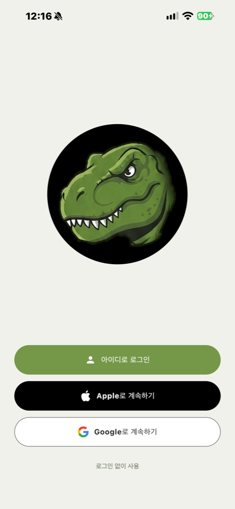
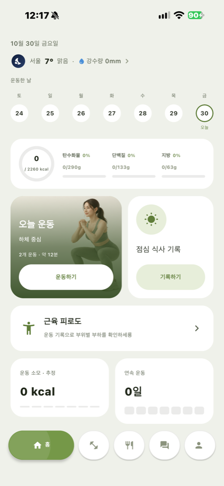

<div align="center">


# TREX

### 휴대폰 카메라로 자세를 보는 운동·식단 앱

[](https://github.com/LeeDongHyun00/TREX/releases)
[](https://github.com/LeeDongHyun00/TREX/releases)
[](#다운로드)
[](#개발)

**[⬇ TREX 1.3.0-preview.7 APK 다운로드](https://github.com/LeeDongHyun00/TREX/releases/download/v1.3.0-preview.7/TREX-1.3.0-preview.7.apk)**

[다운로드](#다운로드) · [기능](#주요-기능) · [검증 범위](#검증-범위와-알려진-한계) · [개발](#개발) · [문서](#문서)




</div>

Kotlin과 Jetpack Compose로 만든 운동·식단 관리 앱입니다.
휴대폰 카메라로 관절을 추정해 자세 변화·반복·유지 시간을 안내하고 루틴과 수행 기록을 기기에 저장합니다.
계정을 연결하면 기록을 서버에 백업하고 기기 간에 이어 쓸 수 있습니다([시스템 구성](#시스템-구성-계정-백업동기화)).

## 왜 TREX인가

- **기기 안에서 봅니다.** 카메라 자세 평가와 음식 사진 분석은 휴대폰 안에서 처리합니다.
- **보지 못한 것은 보지 못했다고 말합니다.** 촬영 방향이나 가림 때문에 판정하지 못한 항목을 정상으로 세지 않고, 판정이 하나도 없으면 점수를 내지 않습니다.
- **검증된 기준과 검증 중인 기준을 나눠 보여줍니다.** 검증 중인 기준은 화면에 '참고'로만 표시하고 음성으로 말하거나 점수에 넣지 않습니다.
- **가르칠지, 기록할지 고를 수 있습니다.** **자세 교정** 모드는 표준 자세를 기준으로 안내하고, **기록 모드**는 내 방식을 그대로 기록합니다.

## 주요 기능

### 운동

- 운동별 횟수 또는 시간·세트·휴식 설정과 루틴 순서 변경
- 카메라 자세 교정·기록 모드, 운동별 촬영 방향·준비 안내
- 화면·음성 교정과 자동 반복·플랭크 유지 시간 표시
- 세트 결과와 날짜별 운동 기록, 최근 7일 기록 조회
- 기록 기반 근육별 부하 추정과 3D 사용 근육 표시
- 창 크기·접힘 경계와 운동 중 가로·세로 방향을 고려한 배치

**운동 방법** 가이드는 총 10종목입니다.

| 종목 | 시범 |
|---|---|
| 기본 스쿼트 · 런지 · 덤벨 컬 | GIF |
| 크로스 런지 · 사이드 런지 · 스탠딩 니업 · 스탠딩 사이드 크런치 | GIF |
| 크런치 · 레그 레이즈 | GIF |
| 플랭크 | 정지 이미지 |

목록·운동 선택·세션에서 같은 **운동 가이드 / 주의사항** 두 탭을 볼 수 있습니다.
레그 레이즈는 바닥에 누워 두 다리를 함께 드는 동작, 플랭크는 전완 지지 자세를 안내합니다.

### 식단

- 음식 검색·직접 등록·섭취량 수정과 끼니별 영양 기록
- 촬영·갤러리 사진의 기기 내 음식 분석과 결과 수정
- 수정한 음식 정보를 기억해 다음 분석에 활용
- 날짜별 식단과 섭취 영양 조회

### 계정 백업·동기화

- 시작 화면의 **아이디로 로그인 / Apple로 계속하기 / Google로 계속하기 / 로그인 없이 사용**
- 아이디 로그인은 앱에서 바로 회원가입할 수 있습니다(비밀번호 찾기는 아직 없습니다). Apple 로그인은 iPhone과 Android 모두 지원합니다.
- 설정의 계정 연결·아이디로 로그인·가입·지금 동기화·회원 탈퇴
- 계정 없이도 모든 기능을 쓸 수 있고, 운동·식단 기록은 기기에 저장됩니다.

preview.7 APK에는 이 계정 기능이 들어 있지 않습니다. preview.7의 로그인·온보딩 화면은 체험용이며 서버 계정 인증에 연결되어 있지 않습니다.

## 다운로드

**[TREX 1.3.0-preview.7 APK](https://github.com/LeeDongHyun00/TREX/releases/download/v1.3.0-preview.7/TREX-1.3.0-preview.7.apk)** ·
[릴리스 설명·파일·체크섬](https://github.com/LeeDongHyun00/TREX/releases/tag/v1.3.0-preview.7) ·
[상세 배포 문서](docs/ANDROID_PREVIEW_RELEASE_1_3_0_7.md)

| 항목 | 현재 배포본 |
|---|---|
| 버전 | `1.3.0-preview.7` |
| 버전 코드 | `12` |
| Android | 8.0 이상(API 26) |
| 패키지 | `com.example.trex_kotlin` |
| 서명 | 기존 체험판과 동일한 개발 인증서 |
| 서명 인증서 SHA-256 | `3027771596e23100d4203da03cd44c4a81f5e3d4cf197fdb7fb2ba4e4dc751ef` |
| 릴리스 자산 | APK · `SHA256SUMS.txt` · `BUILD_INFO.json` |

### 처음 설치하기

1. Android 8.0 이상 휴대폰에서 APK를 내려받습니다.
2. 파일을 열고 필요한 경우 브라우저·파일 앱 또는 TREX의 **이 출처의 앱 허용**을 켭니다.
3. 앱에서 운동을 선택합니다. 카메라 자세 교정을 사용하면 카메라 권한을 허용하고 촬영 안내에 맞춰 준비합니다.
4. 카메라를 끄면 수동 횟수·시간으로 루틴을 진행할 수 있습니다.

### 업데이트하기

설치한 앱이 공개된 GitHub 릴리스를 확인해 새 버전이 있으면 업데이트 대화상자를 띄웁니다. preview.6(versionCode 11)은 preview.7(versionCode 12)의 업데이트 안내 대상입니다.
동일 서명 앱 위에 **업데이트 설치**하면 기존 기록을 유지할 수 있습니다. 확인 주기·보류 조건은 [배포 문서](docs/ANDROID_PREVIEW_RELEASE_1_3_0_7.md#업데이트)에 있습니다.

### preview.7의 변경

- **크런치·레그 레이즈·플랭크 가이드**: 시작 자세·동작·호흡·주의사항을 추가했습니다. 크런치·레그 레이즈는 GIF, 플랭크는 첫 프레임 정지 이미지입니다.
- **바닥 운동**: 크런치·레그 레이즈의 반복 추적과 플랭크 유지 시간 처리를 개선했습니다.
- **자세와 횟수**: 스쿼트 복귀·발끝·무릎 벌림과 덤벨 컬·런지·한 다리 운동의 판별·교정 안내를 보완했습니다.
- **음성과 시선**: 말하기 대기열·준비 설명을 정리하고 바닥 세 종목에 시선 벗어남·복귀 안내를 추가했습니다.
- **촬영 화면**: 세션 중 폰 방향을 따라 가로·세로 배치를 전환하고 뼈대·교정 화살표를 보완했습니다.

## 검증 범위와 알려진 한계

preview.7은 앱 단위 테스트 **704건**, 재생기 테스트 **144건**, 로그 검증 **54/54**가 통과했습니다.
release APK 빌드·필수 lint·서명 검증과 업로드 자산의 해시 일치를 확인했습니다.
**이번 릴리스의 실제 휴대폰 화면·운동 세션 검증은 수행하지 않았습니다.**

가림·촬영 방향·관절 추정 때문에 자세 판정과 반복·유지 시간이 실제 수행과 다를 수 있습니다.
판정하지 못한 항목과 참고 단계의 결과는 확정 판정과 구분해 읽어야 합니다.
허리 접지나 시선의 모든 오류를 관측할 수 있는 것은 아니며 일부 기준은 폰 라벨 검증 중입니다.
생성 시범은 연속 촬영이나 전문가 검수를 거친 교육 영상이 아닙니다.
근육별 부하는 운동 기록 기반 추정치이며 생리학적 피로나 회복 완료를 측정하지 않습니다.

현재 APK는 개발 인증서로 서명한 체험판입니다. 서명이 다른 개발 APK와 충돌하면 기록 보존을 위해 기존 앱을 먼저 삭제하지 마세요.
문제가 확인되면 기록을 보존하면서 더 높은 버전 코드의 수정판으로 업데이트합니다.

## iPhone

iPhone 앱은 Android와 같은 화면·자세 엔진을 Compose Multiplatform으로 공유합니다. 임계값·횟수·음성 안내 정책이 Android와 같습니다.
Mac 빌드·설치 절차는 [iPhone 실행 안내](docs/IOS_INSTALL.md), 구조와 Android를 바꿀 때 함께 할 일은 [iOS 포팅](docs/IOS_PORT.md)에 있습니다.

---

## 개발

- 이번 릴리스 빌드 환경: JDK 21, Android SDK 36 (JVM 컴파일 대상 Java 17, 최소 실행 SDK 26)
- Gradle Wrapper 포함, 별도 Gradle 설치 불필요

```bash
git clone https://github.com/LeeDongHyun00/TREX.git
cd TREX
chmod +x gradlew
./gradlew :app:testDebugUnitTest
./gradlew :app:assembleDebug
```

Android Studio에서 프로젝트 루트를 열고 Gradle Sync 뒤 `app` 실행 구성으로 실행합니다. SDK 경로는 `local.properties` 또는 `ANDROID_HOME`으로 지정합니다.
Windows는 `.\gradlew.bat`을 씁니다. 자세 엔진을 수정할 때는 [작업 지침](AGENTS.md)과 [인수인계](docs/POSTURE_HANDOFF.md)를 먼저 읽습니다.

### 개발자 빌드와 배포 빌드

직접 빌드하면 실제 휴대폰 검증용 기록 도구(세트 로그·음성 기록·자가 라벨·횟수 검증 모드)가 켜집니다. 자세 판정·횟수 세기·음성 코칭은 두 빌드가 같습니다.

| | 개발자 빌드(기본) | 배포 빌드 |
|---|---|---|
| Android | `./gradlew :app:assembleRelease` | `./gradlew :app:assembleRelease -Ptrex.distribution=true` |
| iPhone | Xcode 실행·`xcodebuild …`(설정 없음)·Sideloadly 설치 | App Store·TestFlight 설치본(자동) 또는 `xcodebuild … TREX_DEV_TOOLS=NO` |
| 버전 이름(Android) | `1.3.0-preview.7-dev` 처럼 `-dev`가 붙음 | 붙지 않음 |

release 변형도 기존 체험판과 동일한 개발 인증서로 서명하고, `scripts/publish_release.sh`는 `-dev` APK를 올리지 않습니다.
iPhone은 App Store·TestFlight로 설치된 앱이면 빌드 설정과 상관없이 기록 도구가 꺼집니다(스펙 §120).
기록 도구의 저장 위치·켜고 끄기·로그 회수는 [실검증 도구](docs/DEV_TOOLS.md)에 있습니다.

## 구조

앱과 서버를 함께 둔 모노레포입니다. 둘은 서로 독립된 빌드이고, 루트 Gradle Wrapper는 **Android 앱만** 빌드합니다. 서버는 `server/`에서 별도로 빌드합니다.

| 위치 | 내용 | 빌드 |
|---|---|---|
| `app/` | Kotlin·Jetpack Compose 앱 | 루트 `./gradlew :app:assembleDebug` |
| `app/src/main/java/com/example/trex_kotlin/posture/` | 자세·반복·코칭·세트 리포트 엔진 | — |
| `app/src/main/assets/exercise_guides/` | 운동별 GIF·정지 이미지 | — |
| `posture-core/`, `ios-ui/`, `iosApp/` | iPhone 공유 엔진(생성본)·공유 화면·앱 셸 | Mac — [iPhone 실행 안내](docs/IOS_INSTALL.md) |
| `server/` | REST API 서버 (Spring Boot / Java 17) — 계정·동기화, AWS 운영 배포 파일(`server/deploy/`) | `cd server && ./gradlew bootRun` |
| `research/` | 자세 평가 연구·재생·검증 코드 | — |
| `docs/` | 설계·릴리스·인수인계 문서 | — |
| `training/` | 음식 인식 학습·평가 자료 | — |
| `assets/` | 디자인·원본 이미지 자료 | — |
| `trex_design_react/` | React 디자인 프로토타입 | — |

### 시스템 구성 (계정 백업·동기화)


앱은 **계정 없이도 모든 기능을 쓸 수 있고**, 기록은 기기에 저장됩니다. 아이디·Apple·Google 계정으로 로그인하면 기록을 서버에 백업해
앱을 다시 설치하거나 기기를 바꿔도 이어서 쓸 수 있습니다.

| 구성 요소 | 역할 |
|---|---|
| 앱 (Android · iPhone) | 시작 화면의 **아이디로 로그인 / Apple로 계속하기 / Google로 계속하기 / 로그인 없이 사용**, 설정의 계정 연결·지금 동기화·회원 탈퇴. 기록이 바뀌면 3초 모아 서버에 올리고, 앱 시작·로그인 때 더 최신 기록을 받습니다 |
| Google · Apple | 앱이 받은 ID 토큰을 서버가 각 사의 공개키(JWKS)로 검증합니다 — 앱이 보낸 사용자 정보를 그대로 믿지 않습니다. Android의 Apple 로그인은 Apple 웹 로그인을 거쳐 서버가 앱으로 돌려보냅니다. Apple 계정은 회원 탈퇴 때 Apple 연결도 끊습니다 |
| 아이디 로그인 | 아이디·비밀번호 가입과 로그인을 서버가 직접 처리합니다. 5번 실패하면 10분 동안 잠깁니다 |
| DuckDNS | 무료 도메인 `trex-api.duckdns.org`. HTTPS 인증서는 IP 가 아니라 도메인에만 발급되기 때문에 씁니다 |
| EC2 (Ubuntu · Docker Compose) | Caddy(HTTPS 인증서 자동 발급·갱신) → Spring Boot 서버. 서버 포트(8080)는 밖으로 열지 않습니다 |
| RDS PostgreSQL | 회원·동기화 데이터. 퍼블릭 접근 없이 EC2 보안 그룹에서만 접속합니다 |

동기화 규칙

- 항목(프로필·운동 계획·운동 기록·식단·물·직접 등록한 음식·영양 목표)마다 통째로 백업하고, 같은 항목은 **나중에 바꾼 쪽이 이깁니다**.
- 처음 연결할 때 서버가 비어 있으면 이 기기 기록을 올리고, 이 기기가 비어 있으면(새 기기) 서버 기록을 받습니다. 양쪽에 모두 기록이 있으면 어느 쪽을 쓸지 묻습니다 — 자동으로 섞지 않습니다.
- 내 음식 사진 기억(사진 특징값)과 자세 기준선·자세 로그는 서버로 보내지 않습니다.
- 회원 탈퇴는 서버의 계정과 백업을 모두 지우고, 기기의 기록은 남깁니다.

이 기능은 v1.3.0-preview.7 APK 까지는 들어 있지 않습니다. 공개 릴리스에는 개인정보 처리방침·동의 화면을 붙인 뒤 포함할 예정입니다.
서버 설정(로컬 `application.yml`·운영 환경변수)·API·Google 로그인 설정·운영 배포 런북은 [서버·로그인·동기화 인수인계](docs/SERVER_SYNC_HANDOFF.md)에 있습니다.
구성도 원본은 [`docs/architecture/trex-aws.drawio`](docs/architecture/trex-aws.drawio)입니다.

## 문서

체험판 바이너리는 [GitHub Releases](https://github.com/LeeDongHyun00/TREX/releases)에서 제공합니다.
APK 무결성은 `SHA256SUMS.txt`, 버전·서명·빌드 커밋은 `BUILD_INFO.json`으로 확인합니다.

- [preview.7 릴리스](docs/ANDROID_PREVIEW_RELEASE_1_3_0_7.md)
- [실검증 도구](docs/DEV_TOOLS.md)
- [바닥 3종목 가이드 설계](docs/CORE_EXERCISE_GUIDE_DESIGN.md)
- [운동 가이드 UI](docs/EXERCISE_GUIDE_UI.md)
- [자세 평가 인수인계](docs/POSTURE_HANDOFF.md)
- [자세 엔진 정본 스펙](research/aihub_fitness/KOTLIN_PORTING_SPEC.md)
- [서버·로그인·동기화 인수인계](docs/SERVER_SYNC_HANDOFF.md)
- [iPhone 실행 안내](docs/IOS_INSTALL.md) · [iOS 포팅](docs/IOS_PORT.md)
