# 격차 항목(G1~G11) 화면·시스템 프로토타입 설계 (2026-11-05)

상태: **설계 — 구현 전.** 페이지 단위 계획(라우트·진입·구성·우선순위)은 `docs/GAP_PAGE_PLAN.md`. 격차 분석은 `docs/COMPETITOR_GAP_LIFTOFF_FLEEK.md`(이하 격차 문서). 이 문서는 그 G1~G11 을 **화면(§1)** 과 **시스템(§2~§6)** 으로 구체화한다.

클릭 프로토타입: **`docs/prototype/competitor-gap/index.html`** — 브라우저로 열면 된다(의존성 없음, 오프라인). 색·모양은 앱 테마(`TrexTheme.kt`)와 같고 화면 9개를 위 버튼으로 오간다. 숫자는 전부 예시이고 자세 판정·점수 계산은 들어 있지 않다. 아래 그림은 Playwright 로 찍은 그 화면이다.

사용자 결정이 필요한 것은 격차 문서 §8 과 같다 — 특히 **7일 삭제 해제(G1)** 는 2026-10-28 결정을 바꾸는 일이라 이 설계는 "해제한다" 를 전제로 쓰되 §2.2 에 되돌릴 수 있는 길을 남겼다.

---

## 1. 화면 설계

### 1.1 기록 — 월 달력 + 날짜 카드 + 주간 요약 (G1·G3·G9)

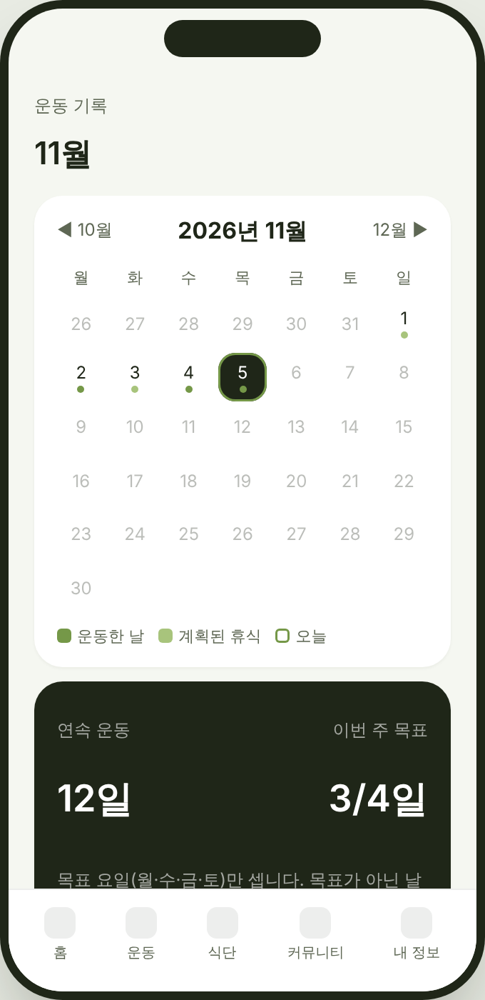 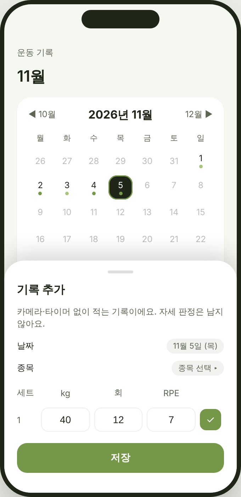

| 요소 | 내용 | 데이터 |
|---|---|---|
| 월 달력 | 운동한 날 진한 점, 계획된 휴식(목표 요일 아님) 연한 점, 오늘 테두리. 좌우로 달 이동. 보관 기간 밖의 달은 비어 있고 "보관 기간 밖" 안내 | `history_YYYYMM`(§2.2), `UserProfile.dayMask` |
| 연속·주간 목표 카드 | 연속 일수는 **목표 요일만** 센다(§4.2). 이번 주 n/N | `StreakState` |
| 날짜 카드 | 종목·세트×무게·RPE·자세 문장·PR 칩·메모 수. '기록 전용' 종목은 회색 칩 | `WorkoutHistoryItem.sets` |
| 기록 추가·수정 시트 | 세션 밖 수동 입력(G9). 날짜·종목·세트 행(kg·회·RPE). **자세 판정은 남지 않는다** 고 시트 안에 밝힌다 | `source = "manual"` |
| 주간 요약 | 운동일·세트, 볼륨(확정 횟수만 — 자동 카운트만 있는 세트 수를 '추정 n세트' 로 표시), 부위 비중(`routineOverview` 분류 재사용) | §3.2 |

지금의 `RecordScreen`('최근 7일')을 대체한다. 진입은 설정 → 운동 기록, 운동 탭 리모트 → 기록, 홈 '운동한 날' 점 줄.

### 1.2 종목 상세 (G3)

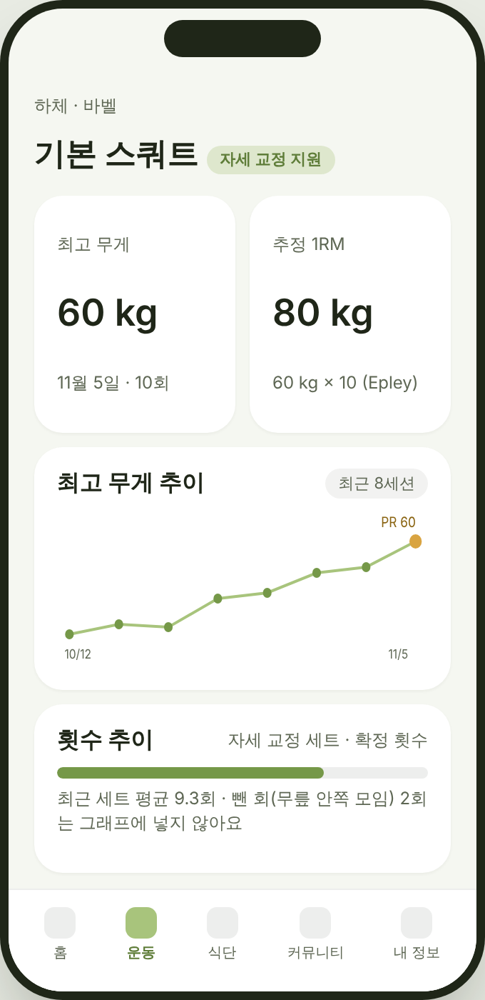

- 최고 무게 · 추정 1RM(§3.3) · 최고 무게 추이(최근 8세션, PR 점 강조) · 횟수 추이(자세 교정 세트의 **확정 횟수**, 뺀 회는 그래프 밖) · 세트 이력 · 가이드 진입.
- 맨몸 종목은 무게 카드 대신 '최고 횟수'·'누적 횟수'. 시간 종목(플랭크)은 최장 유지·누적 시간.
- 진입: 카탈로그 행 · 날짜 카드의 종목 · 완료 화면의 PR 배너.

### 1.3 세트 입력 — 휴식 화면 (G2)

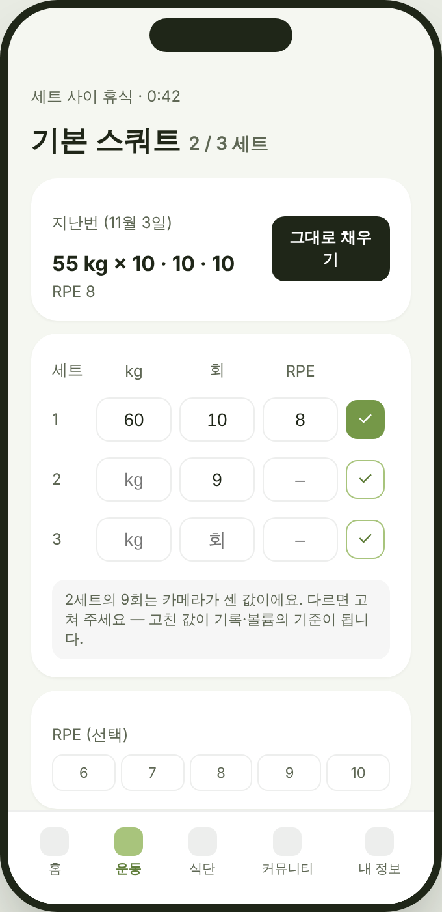

- 상단에 **지난 세션 인라인**("55 kg × 10 · 10 · 10 · RPE 8") + '그대로 채우기'(빈 칸만 채운다).
- 세트 행 kg · 회 · RPE · 완료. kg 0.5 단위, 맨몸이면 비움. 카메라 세션은 '회' 에 자동 카운트가 미리 들어오고 **사용자가 고치면 `actualReps`**, 안 고치면 `countedReps` 만 남아 볼륨은 '추정'.
- RPE 칩 6~10(선택), 종목별 메모.
- 타이머 세션(`TimerSessionScreen`)의 '횟수 기록' 도 같은 행 컴포넌트를 쓴다.

### 1.4 완료 화면 + 보상 띠 (G5)

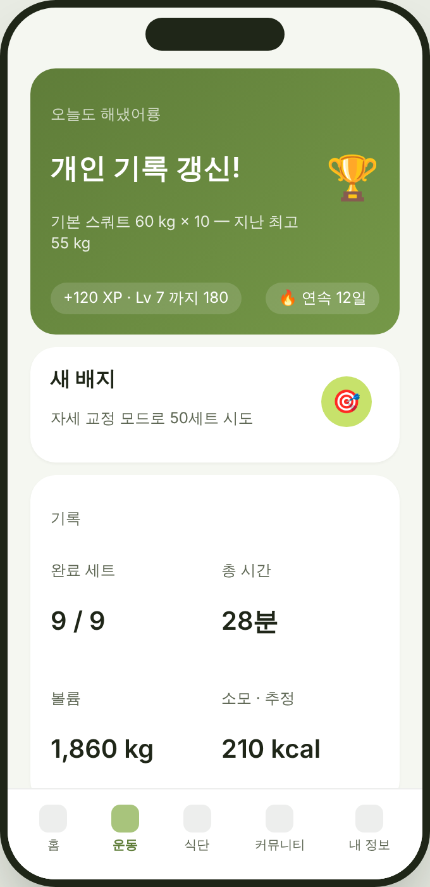

- 맨 위 띠: PR 갱신(종목·새 기록·이전 기록) · +XP · 연속 일수 · 새 배지. **트리거는 "세션을 마치고 기록했다"**(§4.1). 자세 점수·자동 카운트·COACH 정확 횟수는 보상에 들어가지 않는다.
- 아래는 지금 완료 화면 그대로(세트·시간·kcal·근육 맵·자세 문장·자가 라벨·오운완). 볼륨 칸 추가.
- 오운완 카드(`community/WorkoutCard.kt`)에는 XP·배지를 넣지 않는다 — 카드에 판정을 넣지 않는 기존 결정과 같은 선.

### 1.5 업적 (G5)

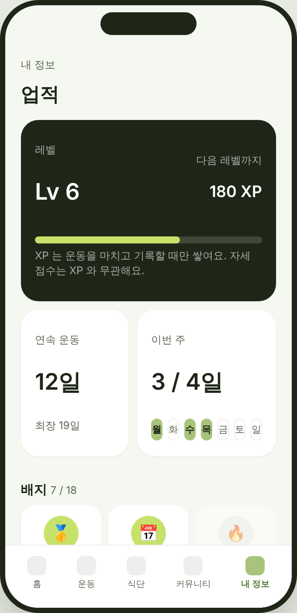

- 내 정보 → 업적. 레벨·XP 바, 연속(현재·최장·이번 주 요일 점), 배지 격자(획득/미획득 흐림).
- 화면 안 문장으로 원칙을 밝힌다: "XP 는 운동을 마치고 기록할 때만 쌓여요. 자세 점수는 XP 와 무관해요."

### 1.6 추천 루틴 (G6)

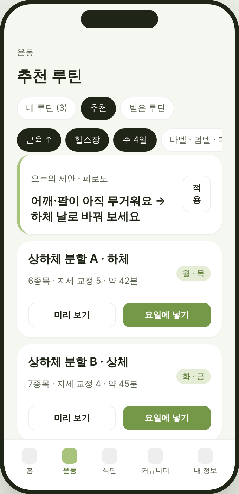

- 운동 탭 상단 탭: 내 루틴(보관함, 기존) · **추천** · 받은 루틴(기존 공유 링크).
- 필터 칩은 온보딩 답(목표·장소·주 N일·장비)으로 미리 켜져 있고 바꿀 수 있다.
- 맨 위 한 줄 "오늘의 제안": 피로도(`MuscleLoadEngine.recommendations`)·날씨(`WeatherExerciseRecommender`) 를 **루틴 단위** 문장으로. '적용' 은 오늘 슬롯을 다른 프리셋으로 바꾼다.
- 프리셋 카드: 이름·종목 수·그중 자세 교정 지원 수·예상 시간(`timing()` 합산)·배정 요일. '미리 보기' / '요일에 넣기' / (오늘 슬롯이 비었으면) '오늘 루틴으로'.
- 안내문: 프리셋은 팀이 쓴 분할 템플릿이고 "당신에게 맞다" 고 단정하지 않는다.

### 1.7 주간 루틴 — 요일 슬롯 (G6)

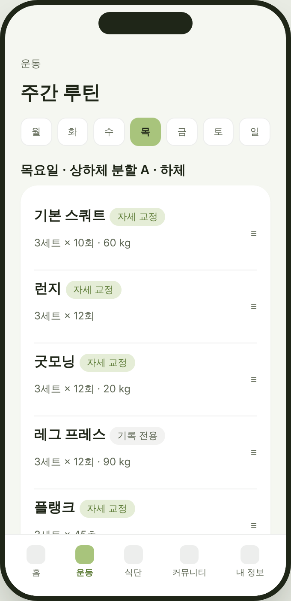

- 요일 7칸, 오늘이 기본 선택. 칸마다 루틴 하나(없으면 휴식). 홈 '오늘 운동' 카드와 '운동 시작' 은 오늘 요일 슬롯을 읽는다.
- 목록 행은 지금 `WorkoutListScreen` 그대로(드래그·스와이프 삭제·자세 토글·수정). 기존 '오늘 루틴'(`plan`)은 **'매일' 슬롯**으로 이관(§5).

### 1.8 운동 목록 — 2층 카탈로그 + 직접 추가 (G4)

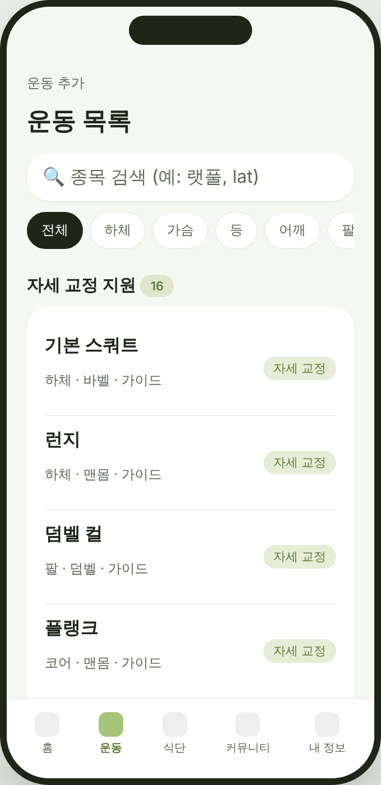 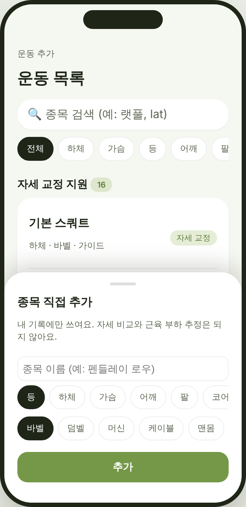

- 검색(한글·영문 별칭), 부위 탭(전체·하체·가슴·등·어깨·팔·코어·유산소), 기구 필터.
- 섹션 둘: **자세 교정 지원(16)** — 기존 `postureExerciseMap` 종목, 초록 칩 / **기록 전용(n)** — 회색 칩 "자세 비교 미지원". 자세 교정 26종목 중 자세 미지원 10개(데드리프트 등)는 기록 전용 섹션에 나타나되 가이드가 있으면 가이드 표시.
- '직접 추가' 시트: 이름·부위·기구(·근육 선택). "내 기록에만 쓰여요. 자세 비교와 근육 부하 추정은 되지 않아요."

### 1.9 설정 — 보관·내보내기·알림·연동 (G1·G7·G8·G10)

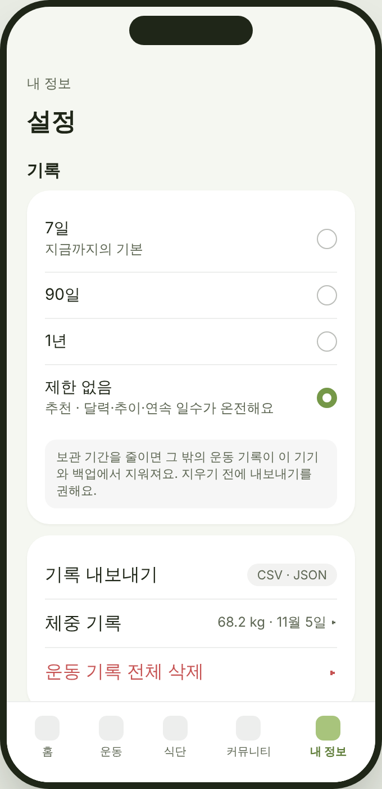

- 기록 보관 기간 라디오: 7일(지금까지의 기본) · 90일 · 1년 · **제한 없음(추천)**. 줄이면 삭제 경고 + 내보내기 권유.
- 기록 내보내기(CSV·JSON), 체중 기록(이력 화면 진입), 전체 삭제(확인 2단계).
- 알림 토글: 운동 요일(시각), 휴식 끝, PR·연속(끊기기 전날). 커뮤니티 알림은 비목표 유지.
- 연동(2차 라벨): Health Connect / HealthKit, 워치(미정).

---

## 2. 시스템 설계 — 저장·보관·동기화

### 2.1 모델 변경 (공유 파일 — `ios-ui/android-sources.txt` 제약 준수)

```kotlin
// TrexData.kt — 기존 필드는 그대로, 아래를 더한다
@Immutable data class SetEntry(
    val index: Int,
    val reps: Int? = null,            // 사용자 확정 횟수(수동 입력·자가 라벨)
    val countedReps: Int? = null,     // 카메라 자동 카운트(beta) — 확정과 구분
    val seconds: Int? = null,         // 시간 종목
    val loadKg: Double? = null,       // 기구 무게. null = 맨몸/미입력. 체중이 아니다
    val rpe: Int? = null,             // 6..10
    val done: Boolean = true,
)
// WorkoutHistoryItem 에 추가
val sets: List<SetEntry> = emptyList(),
val note: String? = null,
val exerciseId: String? = null,       // 카탈로그 id(§3.1). null 이면 workoutName 으로 해석(구기록)
val source: String = "session",       // "session" | "timer" | "manual"
val rulesVersion: String? = null,     // 자세 요약이 있을 때 그 시점 규칙 버전 — 장기 보관 시 ship/beta 변동 구분

// Workout(계획 항목)에 추가
val loadKg: Double? = null,           // 계획 무게(기본값 채우기용)
```

- `reps: String`("12회 × 3세트")·`accuracy`·`loadSet` 은 호환을 위해 남기고 요약은 `sets` 에서 다시 만든다. `LoadSet.weightKg` 는 **체중**이므로 이름을 바꾸지 않고 KDoc 만 보강한다. 기구 무게는 `LoadSet.loadKg`(nullable) 로 따로 더해 `MuscleLoadEngine` dose 가 `docs/MUSCLE_LOAD_RECOVERY_DESIGN.md` §202 식으로 반영한다.
- 체중 이력: `BodyEntry(epochDay, weightKg, bodyFatPct?)` 리스트, 키 `body`. 프로필 `weightKg` 는 최신 항목의 캐시.

### 2.2 보관 기간 분리 (G1)

| 지금 | 제안 |
|---|---|
| `RECORD_WINDOW_DAYS = MuscleLoadEngine.RETENTION_DAYS = 7` 하나가 화면 창·삭제 컷오프를 겸한다 | **셋으로 나눈다**: `FATIGUE_WINDOW_DAYS = 7`(피로도 계산, 불변) · `RecordRetention.policy`(삭제, 사용자 설정: 7/90/365/∞, 기본 ∞) · 화면 창은 달력이 달 단위로 읽는다 |
| `pruneExpiredHistory(today)` 가 앱 시작·30 s 마다 7일 밖을 지움 | `RetentionPolicy.cutoffEpochDay(today)` 가 null(∞)이면 아무것도 지우지 않는다. 같은 호출 자리 유지 |
| `MuscleLoadStore` `DELETE load_sets WHERE ended_at < cutoff` | 같은 정책을 따른다. 피로도 **계산**은 7일 창을 유지(감쇠 24 h 반감기라 7일 밖은 0 에 수렴 — 결과 불변) |
| `history` 한 JSON 문자열 | **월별 키 `history_YYYYMM`** + 색인 `history_index`(존재하는 달 목록). 달력은 보이는 달만 읽고, 주간 요약은 두 달까지 |

**동기화**: `SyncRules.KEYS` 에 `history_*` 접두 규칙·`body`·`achievements`·`custom_workouts`·`schedule`·`settings_records` 를 더한다. 통째 백업(D5)이라 바뀐 달만 올라가고 서버 스키마 변경은 없다. 옛 앱은 모르는 키를 무시한다(`SyncRules.kt:57`) — 새 앱이 올린 월 키를 옛 앱이 지우지 않는다.

**되돌리기**: 정책을 7일로 두면 지금과 같은 동작이다. 기본값을 ∞ 로 할지 7일로 할지가 사용자 결정(격차 문서 §8-1).

### 2.3 내보내기 (G10)

- CSV: `date, exercise, set, load_kg, reps, counted_reps, seconds, rpe, source, note`. JSON: `history_*` 원본 + `body`. 공유 시트로 내보낸다(`PlatformUi` 짝 `shareFile`). 개인정보 처리방침의 '내 데이터' 항목과 맞춘다.

---

## 3. 시스템 설계 — 카탈로그·통계

### 3.1 2층 카탈로그 (G4)

```kotlin
data class CatalogEntry(
    val id: String,                   // "aihub:barbell_squat" | "lib:leg_press" | "custom:<uuid>"
    val name: String, val aliases: List<String>,
    val bodyPart: BodyPart, val equipment: Equipment,
    val muscles: List<MuscleRole>,    // 비어 있으면 근육 부하 추정 없음(커스텀)
    val tier: Tier,                   // POSTURE(16) | CATALOG26(자세 미지원 10) | LIBRARY | CUSTOM
    val guide: ExerciseGuide?,
)
```

- 기존 `workoutCatalog`(26) 는 `aihub:` 접두로 그대로. **앱 이름 26개 불변**, `WorkoutNames.canonical` 유지. `postureSupported()` 는 `tier == POSTURE` 와 같다.
- `lib:` 종목은 `assets/exercise_library/library.json`(이름·별칭·부위·기구·근육). 출처 후보: wger(CC-BY-SA)·free-exercise-db(Unlicense) — **라이선스·한국어 이름은 사용자 결정**. 1차 분량 300±.
- 커스텀은 키 `custom_workouts`(커스텀 음식과 같은 꼴). 기록은 `exerciseId` 로 연결되므로 이름을 바꿔도 이력이 끊기지 않는다.

### 3.2 볼륨·주간 요약

- 세트 볼륨 = `loadKg × reps`(둘 다 있을 때). `reps` 가 없고 `countedReps` 만 있으면 **추정 세트**로 세고 합계 옆에 '추정 n세트'. 맨몸·시간 종목은 볼륨 밖.
- 부위 비중은 `routineOverview` 의 timing 분류 그대로(생리학 수치 아님 — 기존 문구 유지).

### 3.3 PR 과 추정 1RM

- PR 종류: 최고 무게(같은 종목, reps ≥ 1) · 최고 횟수(맨몸) · 최장 시간(시간 종목). 세션 저장 시 `PrDetector.detect(history, newItem)` → `PrEvent` 목록 → 완료 화면 띠·날짜 카드 칩·업적 트리거.
- 추정 1RM = Epley `w × (1 + r/30)`, **r ≤ 10 인 세트만**(Liftoff 는 30 까지 허용해 "무게 편중" 불만). 추정이라고 화면에 쓴다. 맨몸 종목은 계산하지 않는다.
- 비교 대상은 `reps`(확정)뿐. `countedReps` 만 있는 세트는 PR 후보가 아니다.

---

## 4. 시스템 설계 — 보상 (G5)

### 4.1 트리거 표

| 사건 | XP | 조건 | 자세·카운트 의존 |
|---|---|---|---|
| 세션 완료(완료 화면 도달) | +50 | 세트 1개 이상 `done` | 없음 |
| 세트 완료 | +5 (세션당 상한 20세트) | `done` | 없음 |
| 기록 작성(수동 포함) | +20 | 그날 첫 기록 | 없음 |
| PR 갱신 | +50 | §3.3, 확정 횟수 기준 | 없음 |
| 가이드 열람 | +10 | 종목당 1회 | 없음 |
| 자세 교정 모드 세트 시도 | +0 (배지 카운터만) | COACH 로 세트 시작 | **결과가 아니라 시도** |

레벨 = `floor(sqrt(xp / 100))`(100·400·900…). 상한 없음.

**넣지 않는 것**: 자세 점수·정확 횟수·뺀 회 수·판정 0건 세트 — 전부 "카메라가 덜 보면 유리/불리" 를 만든다(원칙 #1·#2, §62b). 알·화폐·상점·연속 복구 구매(Liftoff) — 체험판 비목표.

### 4.2 연속 일수

- `dayMask`(온보딩 주 N일)의 **목표 요일만** 센다. 목표 요일에 기록이 없으면 끊김, 목표 아닌 날은 영향 없음. `dayMask == 0` 이면 매일 기준(지금과 같음) — 단 7일 상한은 G1 로 사라진다.
- 끊기기 전날 저녁 알림(G7, 선택). 복구 구매 없음.

### 4.3 배지

로컬 규칙표 `AchievementRules`(id, 제목, 조건 함수, 아이콘). 1차 18개(프로토타입 1.5 목록). 평가 시점은 세션 저장·가이드 열람·수동 기록 저장 뒤. 저장 `achievements`(획득 id·시각·xp). 서버 검증 없음(1차).

---

## 5. 시스템 설계 — 루틴 (G6)

- `RoutinePreset`(id, 이름, 분할, 조건: goal/place/equipmentMask 부분집합/daysPerWeek 범위, 요일별 `List<Workout>`) 을 `assets/routine_presets/*.json` 으로. 1차 10~12개: 전신 초보(2·3일), 상하체(4일), 푸시·풀·레그(3·6일), 홈트 맨몸(3일), 코어·유산소.
- 선택 규칙: 온보딩 답과 조건 교집합 → 자세 교정 지원 종목 비중 높은 순 → 예상 시간 짧은 순. 조건에 맞는 것이 없으면 전신 초보.
- `schedule` 키: `Map<DayOfWeek, RoutineRef>`(프리셋 id 또는 보관함 루틴 id). **마이그레이션**: 기존 `plan` 은 '매일' 슬롯으로 들어가고, 요일 슬롯이 하나라도 생기면 '매일' 은 "요일이 비어 있을 때" 로만 쓰인다. `planDoneEpochDay` 의 하루 리셋은 그대로.
- '오늘의 제안' 한 줄: 피로도 추천이 오늘 슬롯의 주 부위와 겹치면 "…로 바꿔 보세요", 날씨 추천이 실외 종목을 막으면 "실내 대체". 둘 다 없으면 줄이 없다(설명 문구 없이 생략 — §112 의 교체 추천과 같은 정책).

---

## 6. 시스템 설계 — 알림·연동 (G7·G8)

- Android: `POST_NOTIFICATIONS`(13+), `WorkManager` 주기 작업(운동 요일 알림 = 그 요일 설정 시각, 연속 경고 = 목표 요일 20:00 에 그날 기록 없음), 휴식 끝 알림은 세션 포그라운드 서비스가 아니라 **세션이 백그라운드로 가면 알람 1건**(`AlarmManager.setExactAndAllowWhileIdle` 은 권한이 더 필요해 `setWindow`). 세션 복귀 시 취소.
- iOS: `UNUserNotificationCenter` 로컬 알림 — 같은 세 종류. 공유 경계 `Notifier`(`PlatformUi` 짝 패턴, Android `NotifierAndroid.kt` ↔ `ios-ui/.../NotifierIos.kt`).
- Health Connect / HealthKit(2차): 세션 완료 때 `ExerciseSession`(종목 타입 매핑)·`TotalCaloriesBurned` 쓰기, `Weight` 읽기 → `body`. 권한은 설정 토글에서만 요청.
- 홈 위젯(2차): Glance — 연속 일수·오늘 슬롯 루틴 이름. iOS 위젯은 별도 타깃이라 미정.

---

## 7. 파일 배치와 제약

| 새 파일(공유, `ios-ui/android-sources.txt` 등재) | 역할 |
|---|---|
| `records/RecordCalendarScreen.kt` · `records/ExerciseDetailScreen.kt` · `records/WeeklySummary.kt` | §1.1·1.2 |
| `records/RetentionPolicy.kt`(기존 `RecordRetention.kt` 대체) · `records/HistoryStore.kt`(월별 키) | §2.2 |
| `records/PrDetector.kt` · `records/OneRepMax.kt` | §3.3 |
| `rewards/AchievementRules.kt` · `rewards/XpLedger.kt` · `rewards/Streak.kt` · `rewards/AchievementsScreen.kt` | §4 |
| `catalog/ExerciseLibrary.kt` · `catalog/CustomWorkouts.kt` | §3.1 |
| `routines/RoutinePresets.kt` · `routines/WeeklySchedule.kt` · `routines/RecommendedRoutinesScreen.kt` | §5 |
| `notify/Notifier.kt`(경계) | §6 |

| 플랫폼 짝(목록 밖) | |
|---|---|
| `NotifierAndroid.kt` ↔ `ios-ui/.../NotifierIos.kt` | 알림 |
| `HealthAndroid.kt` ↔ `ios-ui/.../HealthIos.kt` | 2차 |

- 공유 파일에 `java.*`·`android.*`·`@Synchronized` 금지. 시각은 `TrexTime.kt`, 잠금은 atomicfu.
- `PostureLiveSessionScreen` 에 지역 변수를 더하지 않는다 — 세트 입력 상태는 `SetInputState` 홀더로 `LiveSessionRefs` 옆에.
- 자세 엔진(`posture/`)은 건드리지 않는다. 카운트는 `countedReps` 로 받기만 한다.

---

## 8. 테스트 계획

| 대상 | 테스트 |
|---|---|
| `RetentionPolicy` | ∞ 는 삭제 0건 / 90일 경계·DST / 7일은 기존 `RecordRetention` 테스트와 동일 결과 |
| `HistoryStore` | 월 경계 저장·읽기, 구 `history` 키 → 월 키 이관 1회성·멱등, 옛 앱이 올린 `history` 와 공존 |
| `PrDetector`·`OneRepMax` | reps ≤ 10 만, `countedReps` 만 있는 세트 제외, 맨몸 종목 1RM 없음, 최장 시간 |
| `XpLedger`·`AchievementRules` | 표 §4.1 과 1:1, 세트 상한 20, 자세 점수 입력이 바뀌어도 XP 불변(**원칙 잠금 테스트**) |
| `Streak` | `dayMask` 목표 요일만, 0 이면 매일, 7일 넘게 이어짐 |
| `RoutinePresets` | 조건 교집합·빈 결과 폴백·자세 지원 비중 정렬, `plan` → '매일' 이관 |
| `ExerciseLibrary` | 26개 앱 이름 불변, id 접두 충돌 없음, 별칭 검색 |
| `SyncRules` | 새 키 업로드·옛 앱 무시, 월 키 LWW |
| 공유 컴파일 | `bash gradlew -PiosOnly=true :ios-ui:compileKotlinIosArm64`(Mac) |

---

## 9. 구현 순서 (PR 단위 제안)

1. **PR-A 보관 분리·월별 키·내보내기·설정 라디오**(G1·G10) — 다른 것의 전제. 사용자 결정 뒤.
2. **PR-B 세트 모델·입력·이전 기록 채우기·메모**(G2·G9) — 세션 밖 수동 기록 포함.
3. **PR-C 달력·종목 상세·주간 요약·PR·체중 이력**(G3).
4. **PR-D 보상 1차**(G5) — 원칙 잠금 테스트 포함.
5. **PR-E 카탈로그 2층·커스텀**(G4) — 데이터 출처 결정 뒤.
6. **PR-F 프리셋·요일 슬롯·오늘의 제안**(G6).
7. **PR-G 알림**(G7), 물 UI(G11).
8. 2차: Health Connect/HealthKit·위젯(G8), 챌린지·리더보드·루틴 퍼오기.

각 PR 은 `KOTLIN_PORTING_SPEC.md` 에 절을 더하고(저장소 관례) iOS 동기화(`tools/sync_ios_core.py --check`)를 지난다.
